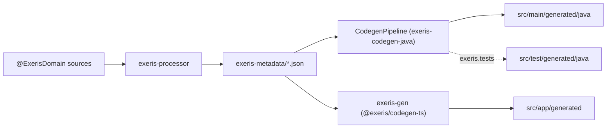
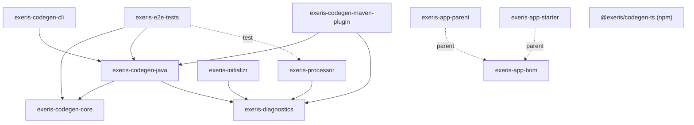

# Architecture

`exeris-tooling` is the build-time pipeline of the Exeris ecosystem. It reads an application's annotated Entity-First sources inside `javac`, writes what it found as `DomainMetadata` JSON, and generates from that JSON a kernel application in Java and a matching Angular application in TypeScript. The output is committed into the application's repository. This page explains how the parts fit together and why the boundaries sit where they do; each module's guarantees are on its [module page](modules/README.md).

The pipeline runs at `javac` time, at `exeris:generate` time and at `exeris-gen` time, never inside the application it generates. It is not a runtime, not a framework and not a host.

## The pipeline end to end

- **Extraction.** `ExerisDomainProcessor` walks `@ExerisDomain`, `@Saga`, `@CapabilityModule` and `@View`, refuses `@Schedule`, and writes `<Entity>.json`, `enum_*.json`, `capability_*.json` and `view_*.json` into the class output. It refuses declarations the generated application cannot serve at the declaration, as `javac` errors with `EXT-PROC` identifiers.
- **The hand-off.** The JSON is the only thing the generators read. They never see an `Element` or a `TypeMirror`; `CodegenCoreArchitectureTest` and `CodegenJavaArchitectureTest` hold that on the bytecode ([DomainMetadata contract](../.agents/policies/domain-metadata-contract.md)).
- **Java emission.** `CodegenPipeline` runs every registered generator over every entity with the whole build in view, then the project-wide files, then prunes what the previous run wrote and this run did not.
- **TypeScript emission.** `exeris-gen` reads the same directory through its Zod mirror of the schema and writes the Angular application.

The Java pipeline has three callers that share one implementation: the [Maven plugin](modules/06-codegen-maven-plugin.md), the [shaded command line](modules/07-codegen-cli.md), and the e2e tests, which call `CodegenPipeline` in-process. `CodegenCliJarIT` holds the jar and the in-process pipeline to byte-identical trees.

## Module graph

The graph is derived from each module's `<dependencies>` and `<parent>`. Solid arrows are compile scope, dotted arrows are test scope or a parent POM. SDK and kernel artifacts are outside the box.

Reading the graph:

- `exeris-processor` and `exeris-codegen-core` do not depend on each other. They meet only through the files the processor writes and the SDK records both deserialize them into.
- `exeris-codegen-core` holds no emission library. JavaPoet is in `exeris-codegen-java`, where `KernelScaffold`'s signatures expose it ([ADR-015](adr/ADR-015-codegen-emission-strategy.md) decision 4).
- No tooling module depends on the kernel runtime. The `ban-host-and-kernel-runtime` enforcer execution keeps `exeris-kernel-core`, `exeris-kernel-community*` and every host framework off the graphs of the processor, codegen-core and codegen-java. Generated code names kernel types; the e2e tests compile and boot it against the real kernel jars.
- `exeris-app-bom` manages the processor, the plugin and the starter. No reactor module declares it as a dependency; `exeris-app-parent` and `exeris-app-starter` inherit it, and applications import or inherit it.
- `@exeris/codegen-ts` has no edge into the reactor. Its only inputs are the metadata directory and, in its tests, the contract files under `exeris-e2e-tests`.

## The metadata contract

The shape of `DomainMetadata` and its record family is defined upstream, in `exeris-sdk-source-model`, and so are its wire rules. Tooling writes and reads those records; it does not copy or shadow them. Each entity file also carries the two ADR-042 trust fields, `schemaVersion` and `sourceDigest`, as siblings of the record's own fields, so a plain `DomainMetadata` read ignores them and a `BaselineTrust` read picks up just those two.

[ADR-042](adr/ADR-042.link.md) requires that the processor and the SDK's design-time `SourceModelReader` produce the same metadata from the same source. The processor makes that executable by binding the SDK conformance kit: producer, reader and parity suites over the SDK corpus, with no facet declared unsupported and a ratchet test that keeps it that way ([processor](modules/02-processor.md)).

The TypeScript side reads through `DomainMetadataSchema`, a Zod mirror of the record. `contract-coverage.ts` classifies every top-level field as `READ`, `JAVA_ONLY`, `RESERVED` or `GAP`, measured by running the orchestrator over proxied metadata, so a field added to the schema fails the TS build until someone classifies what the front does with it. No test in this repository compares the Zod schema with the SDK records, so mirroring a new SDK field is a deliberate change to `exeris-codegen-ts`.

## Extraction: refuse at the declaration

The processor's refusals encode what the generated application needs: a `.domain` package to derive sibling packages from, a `UUID` primary key, the getters and setters the repository binds, a `BlobRef` field type for `@Blob`, saga step orders that run 1 to N. Refusing in `javac` puts the error on the author's line instead of in a later generation failure or a compile error in generated code.

Two switches change what the processor says, not what it writes. `-Aexeris.strict` reports attributes and annotations that no generator consumes. `-Aexeris.metadataOnly` skips `EXT-PROC-1033` and `EXT-PROC-1034`, the two refusals only the generated application needs, for a consumer such as the SDK conformance kit that generates no application.

## Derivations both sides must agree on

Some facts appear twice: once in emitted code and once in a build-time check. `exeris-codegen-core` derives each from the metadata once. `RequiredSubsystems` gives the names the emitted `Application.subsystems()` boots; `RequiredDrivers` gives the SPIs `exeris:verify-runtime` demands a provider for, on the same predicates; `RouteRequirements` gives the requirement each route carries, read by `GeneratedRoutePolicy` and by the OpenAPI security builders. The emitted list and the gate cannot drift, because they are one predicate read twice.

The TypeScript side cannot share that Java code. Its route-requirement and server-owned-field rules are written again in TypeScript, and the contract files in `exeris-e2e-tests/src/test/resources/contract/` pin both: each is read by a Java test and by a TS spec ([e2e tests](modules/10-e2e-tests.md)).

## Java emission: the kernel, only

The pipeline has one target, the Exeris kernel ([ADR-015](adr/ADR-015-codegen-emission-strategy.md), [kernel target only](../.agents/policies/kernel-target-only.md)). For each entity in `<pkg>.domain` it writes sibling packages under `<pkg>`: `handler`, `service`, `repository`, and `event`, `graph`, `saga`, `client` where the metadata asks. Per build it writes, in the base package, `Application`, `RuntimeComponents`, `RuntimeLifecycle` and `GeneratedRoutePolicy`, plus Flyway migrations under `db/migration` and an OpenAPI 3.1 document per entity under `openapi`. Every path, with the generator and condition behind it, is a row of the [generator catalogue](generators.md).

`Application.main()` boots the kernel by subsystem name and composes inside the boot callback, through `RuntimeLifecycle`, because the http subsystem reads its server handler before that callback runs; a forwarding edge handler bridges the two ([ADR-070](adr/ADR-070-generated-composition-root-seam.md)). `RuntimeComponents` and the `protected` hooks of `Application` are where an application substitutes its own service, route, executor or policy without editing generated code. The route policy is the first declared of the application's own policy and the generated one, falling back to `unmatchedRoutes()`, which is `permitAll()` unless overridden ([ADR-105](adr/ADR-105-generated-route-policy-emission.md)).

## TypeScript emission

`@exeris/codegen-ts` writes an Angular 22 application: zoneless, standalone components, Signal Forms ([ADR-093](adr/ADR-093-emitted-forms-are-signal-forms.md)), signal-based stores, and route guards and a bearer interceptor only where some route demands identity. It ships on npm in lockstep with the reactor version, so release `X.Y.Z` of the package reads the JSON of processor `X.Y.Z` ([ADR-092](adr/ADR-092-emitted-typescript-output-stability.md)).

## Committed output: L1, then L2

Generated code is committed into the application's repository ([committed generated code](../.agents/policies/committed-generated-code.md)). At **L1** it lives under `src/main/generated/java` and `src/app/generated`, and each run rewrites what it owns. Ownership is the `.exeris-codegen-manifest` at the root of each tree: a run deletes only what the previous manifest lists and this run did not write, so a hand-written file in the tree is never touched. The Java pipeline also refuses to prune a committed tree when it finds no metadata, because empty metadata is almost always a compile that failed before the processor ran (`EXT-PLUG-2001`).

At **L2** the application runs `exeris:detach`, which moves the generated Java into `src/main/java` byte for byte, drops the ignore entry, and leaves a file that already exists at the target in place. From then on the code is the application's and regeneration stops. There is no reattach; the open question is [RFC-2026-06-05](rfc/RFC-2026-06-05-reattach-edit-safety-and-provenance.md).

The Maven build pays for L1 with a two-pass first build: `exeris:generate` runs at `generate-sources`, before the `compile` in which the processor writes the metadata it reads. `exeris-app-parent` binds the goals, `verify-capabilities` and `verify-runtime` at `process-classes` against fresh metadata, and `exeris-initializr` writes a `first-build.sh` that runs the two passes.

## Determinism and output stability

Because the output is committed, a byte that moves without a reason is a diff in every consumer's repository. Same metadata must give byte-identical output across runs, machines and locales: no timestamps, no random identifiers, no hash-order iteration, `Locale.ROOT`, forward slashes ([codegen determinism](../.agents/policies/codegen-determinism.md)). The pipeline sorts domains by qualified name and reads files in file-name order, so directory listing order never reaches the output. The bytecode rules are held by the architecture tests, the locale rule by `LocaleIndependenceTest`, the OpenAPI document by a committed golden, the TypeScript headers by `header-version-free.spec.ts`, and whole runs by `SdkExamplesE2ETest` and the CI job that generates the SDK examples Angular application twice and compares.

What a change to the output owes consumers is decided by two ADRs, one per emitter. [ADR-015](adr/ADR-015-codegen-emission-strategy.md) governs the emitted Java, SQL and YAML; [ADR-092](adr/ADR-092-emitted-typescript-output-stability.md) governs the emitted TypeScript and the npm package, and defines what is breaking, additive or neither. Each emitter has a ledger of accepted breaking changes: `accepted-api-changes.json` at the repository root for the processor and the Java pipeline, `exeris-codegen-ts/api/accepted-api-changes.json` for TypeScript. Each consumer-visible change also adds a fragment under `docs/migration/<version>/`, which the release assembles into `MIGRATION-0.x-to-1.0.md`. The per-surface commitments are in the [stability matrix](stability-matrix.md).

## The e2e gates

Text assertions cannot show that generated code compiles, boots or agrees with the other emitter. `exeris-e2e-tests` compiles generated sources against the real kernel SPI and Core, boots the emitted `Application` through `KernelBootstrap` and drives it over a socket, runs generated SQL on H2 and, in a separate group, on PostgreSQL, and reads the contract files the TypeScript specs read. `GeneratorCatalogueConformanceE2ETest` fails when an emitted path has no catalogue row. `SdkExamplesE2ETest` takes the SDK's own example corpus at the pinned SDK tag through the processor and the pipeline, so an example a guide quotes that the pipeline cannot carry fails this build ([e2e tests](modules/10-e2e-tests.md)).

## Rejected alternative: generators per host framework

Generators for Spring, Quarkus, Micronaut and Vanilla Java were removed in 0.1.0, and the [kernel target only](../.agents/policies/kernel-target-only.md) policy keeps them out. A generator family per host would make every emitter change one change per host, and the contract files, the boot tests and the stability ledgers one set per host. The cost of the single target is that an application that must run on Spring gets there through `exeris-spring-runtime`, downstream, and not through a generator here.

## Trade-offs

- **One contract, two implementations.** The JSON decouples the Java and TypeScript emitters, which build in different toolchains, at the price of writing each shared rule twice. The contract files catch drift only where a file exists.
- **Refusals in the processor.** Declaration-site errors are the best place for an author, and the processor carries knowledge of the generated application to make them. `-Aexeris.metadataOnly` is the escape for consumers that do not need it.
- **Committed output.** Reviewable, detachable code costs a regeneration diff on every tooling bump that changes an emitter, and a two-pass first build.
- **Prose stability rules.** No tool measures that a regenerated view renders less for the same metadata; ADR-092 leaves that to the author and the reviewer.

## Where this does not apply

This page describes the tooling's own structure. It does not describe the record shapes, which `exeris-sdk` owns ([SDK architecture](https://github.com/exeris-systems/exeris-sdk/blob/main/docs/architecture.md)), how the kernel boots or serves a request, which `exeris-kernel` owns, or what each generator writes in detail, which the [generator catalogue](generators.md) owns. It makes no performance claim: nothing here runs on a request path.
